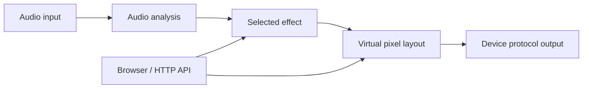

# Document Development

The documentation is written in markdown. Once you are finished
making changes, you must build the documentation. To build the LedFx
documentation follow the steps outlined below:

We have now migrated document dependency management and build to uv
based.

Building should be the same for all platforms.

LedFx documentation builds should be run with Python 3.11 through 3.14 (the supported project range from `pyproject.toml`). Python versions outside this range are explicitly unsupported and may cause non-deterministic failures.

:::: note
::: title
Note
:::

This is most simply built via VScode tasks as per [Docs in VScode](#docs-in-vscode) but instructions are provided below if you work in some other environment.

::::

The docs dependencies are defined in the `pyproject.toml` file, and managed by the uv framework.

See [uv installation guide](https://docs.astral.sh/uv/getting-started/installation/)

Run the following command in the LedFx source directory where pyproject.toml resides.

To install the docs dependencies on top of the dev dependencies:

``` console
uv sync --group dev --group docs
```

If you only want the docs dependencies then instead use:

``` console
uv sync --only-group docs
```

To build the documentation, run the following commands

``` console
$ cd docs
$ uv run sphinx-build -a -b html . build
```

The built docs can be checked in the docs/build directory by opening the index.html file.

## Docs in VScode

Tasks have been added to the .vscode file to make building docs smoother and removing any excuse not to improve them ( hint hint ).

Although there are separate tasks defined in .vscode/tasks.json for
dependency install, build and open in browser, they are configured such
that it should be just a case of launching the task **Build and Open
Docs**

This should ensure dependencies are in place, build the docs and open
the index.html in your default browser.

Error detection in the build process to prevent the browser open is not
yet implemented. This is a future enhancement.

Find vscode tasks through ctrl+shift+p and type \"Tasks: Run Task\" and
select the task **Build and Open Docs**

Or better, install the Tasks extension by actboy168 into vscode and run
the task from the bottom control bar. All tasks except \"Build and Open
Docs\" are hidden to reduce clutter.

## Runtime processing



Repository instructions are in `AGENTS.md` at the repository root.

## Implementation contracts

The API reference is maintained in [assets](apis/assets.md),
[cache](apis/cache.md), and [Now Playing](apis/now_playing.md). These guides provide request formats and response examples.

### Assets, caching, and network safety

User asset paths are relative to the configuration directory's `assets/` folder;
`builtin://` selects bundled assets. Downloads and thumbnails also accept remote
HTTP(S) URLs. Thumbnail size, dimension and animation parameters distinguish
cache variants.

Asset writes validate paths, image extensions, decoded content, and size before
an atomic temporary-file replacement. A successful replacement invalidates
cached thumbnail variants; cache invalidation failure does not undo the saved
asset. Directory `fsync` persists the rename on POSIX, since syncing the file
alone does not persist its directory entry. The helper tolerates OS errors and
skips Windows, where directories cannot be opened with the same API.

The image cache has no TTL: entries remain until explicit refresh/clear or LRU
eviction at size/count limits. Its public operations share a reentrant lock
because image loads run both on the event loop and in worker threads. Cache keys
include URL and sorted parameters; statistics omit thumbnail variants.
`all_variants=true` refresh clears variants without immediately re-downloading;
a normal remote refresh downloads again, and local refresh only removes cache.

URL validation alone does not prevent DNS rebinding. `safe_urlopen` checks the
actual address before connecting, including redirected connections, disables
proxies, and accepts only HTTP(S). Embedded IPv4 destinations in IPv6 addresses
must also be checked. Allowing private media servers does not allow loopback,
link-local or metadata-service destinations. Image validation limits dimensions,
frame count and total decoded animation pixels to contain decompression bombs.
Local MIME checks require a previously validated local path. Logging artwork
URLs strips credentials and query strings, which may contain access tokens.

### Configuration, rendering, and device protocols

Configuration migrations transform deep copies of raw dictionaries without
registry or filesystem access. Invalid JSON container shapes become fresh empty
containers. Preset matching ignores UI-only keys. Startup's lenient plugin load
quarantines invalid values before persisting repairs; failed quarantine prevents
saving the repaired config. Defaults are merged when an effect's presets are
used, after the registry is populated. Plugin registration uses module names;
abstract effect bases use `no_registration` to avoid appearing as choices.

Effects render into `self.pixels`; the prior frame is available there. Complex
configuration-derived state belongs in `config_updated`, while layout-dependent
state may need `do_once`, after matrix width and height exist. Bleep reinitializes
its layout without discarding amplitude history. Pose/text animation deltas are
in seconds; one-shot flash ramp, hold and fade parameters are in milliseconds.
Dummy devices whose IDs start with `gap-` represent empty matrix positions and
are skipped during device processing. Other dummy devices remain browser outputs.

The SciPy-derived sawtooth implementation retains its BSD notice in
`ledfx/effects/math.py`. It has period `2*pi`, output range -1 to 1, and rising
ramp fraction `width` from 0 to 1 (`0.5` gives a triangle); it is not band-limited,
so harmonics can alias. Calibration patterns cache a bright → fade → dim → fade
cycle and animate it by rolling; their default dim factor is 0.2. HSV wave helpers
wrap 0..1 inputs; their clock period is `65.536 / modifier` seconds. Fast perceptual
hue mapping favors speed but may overrepresent green and underrepresent blue.

Mel conversion accepts scalars or arrays. `compute_melmat` returns three values:
`matrix`, `band_centers_hz`, and `fft_frequencies_hz`. The matrix has shape
`(num_mel_bands, num_fft_bands)` and multiplies an FFT spectrum of matching length;
`num_fft_bands = NFFT / 2 + 1`. Explicit band ranges use the same return layout.
This differs from the obsolete two-value plotting example formerly in `mel.py`.

Packet encoders in `ledfx/devices/packets.py` preserve these wire layouts:

| Encoder | Header | Pixel payload |
| --- | --- | --- |
| WARLS | `1, timeout` | Changed pixels only: index, R, G, B |
| DRGB | `2, timeout` | R, G, B |
| Raw RGB | None (HyperHDR UDP raw receiver) | R, G, B |
| DRGBW | `3, timeout` | R, G, B, zero white channel |
| DNRGB | `4, timeout, start high, start low` | R, G, B |
| Adalight | `Ada`, count high/low, XOR checksum | Requested color order |
| OpenRGB | `ORGB`, device ID, command 1050, lengths/count | R, G, B, padding |

OpenRGB activation requires direct mode support. WLED-compatible configuration
must contain `brand`, but its value need not be `WLED`. Receive sockets are shared
by port and close only after their reference count reaches zero.

### Now Playing and development helpers

[Now Playing architecture](developer/dev_notes/now_playing_architecture.md)
describes provider state and events. Sendspin requires Python 3.12 or later and
its optional imports; `UndefinedField` preserves accumulated metadata, while
explicit `None` clears it. Track identity changes exclude playback position.
Album-art providers should remain stateless where practical, catch network
failures internally, and return image bytes or `None`. The internal resolver may
set artwork only while a source is active. Artwork is validated and atomically
saved into a single current-artwork asset before gradient extraction.

Track-text and album-art effects require audio activity and configured target
virtuals. A duration of zero applies the effect permanently; a positive duration
uses the fallback timer. Gradient targeting uses all virtuals when its target list
is empty. Metadata normalization removes channel/video suffixes and placeholder
albums; for example, `MimiWebbVEVO` becomes `Mimi Webb` and `Unknown album` becomes
`None`.

Development helpers: `PerformanceAnalysis.compare_functions` accepts zero-argument
callables; Teleplot values use `name:value`; graph timestamps are seconds since
creation. Release builds package `IS_RELEASE` and `GITHUB_SHA` in `ledfx.env`.
API-test ordering is per group and response assertions may specify subsets.
Cleanup retries released file handles and removes stale configuration to prevent
state pollution.

The PulseAudio client and daemon overrides in `ledfx_docker/pulse/` retain their
upstream LGPL notices. See `pulse-client.conf(5)` and `pulse-daemon.conf(5)` for
configuration syntax. The bundled frontend's license banner points to the
adjacent `main.d9e978f5.js.LICENSE.txt`; preserve that attribution when distributing
or rebuilding the bundle.
